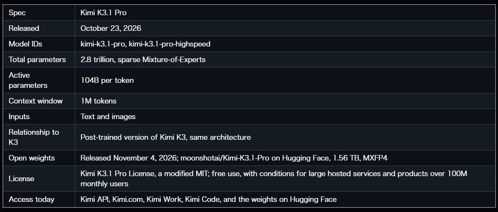
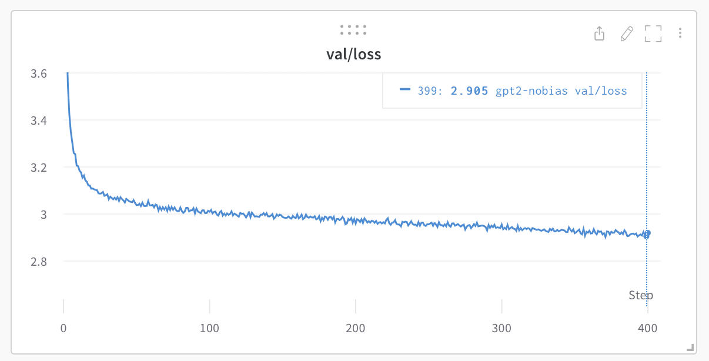
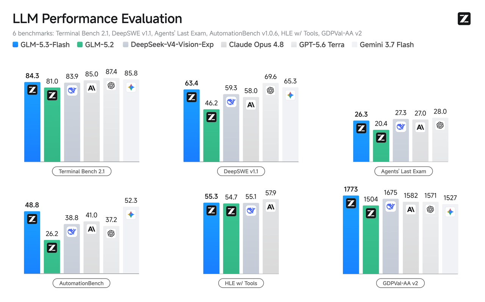
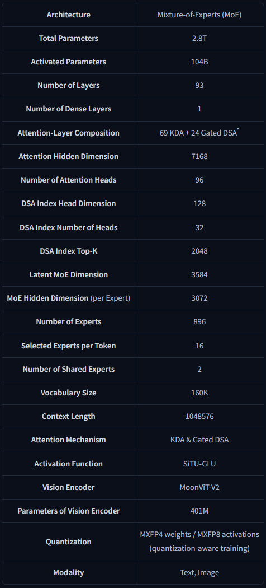
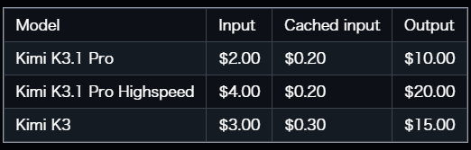
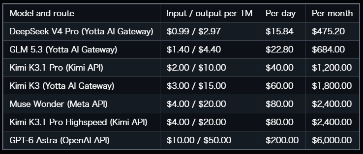

<a id="readme-top"></a>

<!-- PROJECT SHIELDS -->
[![Contributors][contributors-shield]][contributors-url]
[![Forks][forks-shield]][forks-url]
[![Stargazers][stars-shield]][stars-url]
[![Issues][issues-shield]][issues-url]
[![MIT License][license-shield]][license-url]

<!-- PROJECT LOGO -->
<br />
<div align="center">
  <a href="https://github.com/ARGDeveloperShayan/FanoosLLM">
    
  </a>

<h3 align="center">Fanoos AI</h3>

  <p align="center">
    A compact, from-scratch language model stack: tokenizer training, pretraining, supervised fine-tuning, evaluation, OpenAI-compatible serving, and HF/GGUF export.
    <br />
    <a href="https://github.com/ARGDeveloperShayan/FanoosLLM"><strong>Explore the docs »</strong></a>
    <br />
    <br />
    <a href="https://github.com/ARGDeveloperShayan/FanoosLLM">View Demo</a>
    &middot;
    <a href="https://github.com/ARGDeveloperShayan/FanoosLLM/issues/new?labels=bug&template=bug-report---.md">Report Bug</a>
    &middot;
    <a href="https://github.com/ARGDeveloperShayan/FanoosLLM/issues/new?labels=enhancement&template=feature-request---.md">Request Feature</a>
  </p>
</div>

<!-- TABLE OF CONTENTS -->
<details>
  <summary>Table of Contents</summary>
  <ol>
    <li>
      <a href="#about-the-project">About The Project</a>
      <ul>
        <li><a href="#built-with">Built With</a></li>
      </ul>
    </li>
    <li>
      <a href="#getting-started">Getting Started</a>
      <ul>
        <li><a href="#prerequisites">Prerequisites</a></li>
        <li><a href="#installation">Installation</a></li>
      </ul>
    </li>
    <li><a href="#usage">Usage</a></li>
    <li><a href="#training-pipeline">Training Pipeline</a></li>
    <li><a href="#benchmarks">Benchmarks</a></li>
    <li><a href="#model-architecture">Model Architecture</a></li>
    <li><a href="#pricing-comparison">Pricing Comparison</a></li>
    <li><a href="#roadmap">Roadmap</a></li>
    <li><a href="#contributing">Contributing</a></li>
    <li><a href="#license">License</a></li>
    <li><a href="#contact">Contact</a></li>
    <li><a href="#acknowledgments">Acknowledgments</a></li>
  </ol>
</details>

<!-- ABOUT THE PROJECT -->
## About The Project



**Fanoos AI** is a small, fully local language model project built from the ground up. It is designed as a clean, readable reference implementation for training and serving a modern decoder-only Transformer without hiding the important details behind a framework.

The project includes the complete pipeline:

- Custom BPE tokenizer training with ChatML special tokens
- Pretraining on a mixed corpus of educational web text, Wikipedia, synthetic textbook data, and Python code
- Supervised fine-tuning with masked assistant-token loss
- Benchmarking for perplexity, generation speed, prefill speed, factual QA, and qualitative samples
- FastAPI serving with an OpenAI-compatible `/v1/chat/completions` endpoint
- Export to Hugging Face `safetensors` and GGUF for `llama.cpp`
- Optional quantized training with `bitsandbytes`

The current model is a **98.9M parameter** decoder-only Transformer with **12 layers**, **8 attention heads**, **2 KV heads**, a **768-dimensional** embedding, and a **32,000-token** vocabulary. It runs comfortably on a single consumer GPU and is small enough to inspect, modify, and retrain.

<p align="right">(<a href="#readme-top">back to top</a>)</p>

### Built With

* [![Python][Python-badge]][Python-url]
* [![PyTorch][PyTorch-badge]][PyTorch-url]
* [![Hugging Face][HuggingFace-badge]][HuggingFace-url]
* [![FastAPI][FastAPI-badge]][FastAPI-url]
* [![NumPy][NumPy-badge]][NumPy-url]
* [![Apache Arrow][PyArrow-badge]][PyArrow-url]
* [![safetensors][safetensors-badge]][safetensors-url]
* [![bitsandbytes][bitsandbytes-badge]][bitsandbytes-url]

<p align="right">(<a href="#readme-top">back to top</a>)</p>

<!-- GETTING STARTED -->
## Getting Started

This section shows how to set up Fanoos AI locally, prepare the data, train the model, and run the chat server.

### Prerequisites

* **Python 3.11+**
* **CUDA-capable GPU** recommended for training and fast inference
* **pip** and a virtual environment
* Enough disk space for datasets, tokenized binaries, and checkpoints

Install the Python dependencies:

```sh
pip install -r requirements.txt
pip install torch --index-url https://download.pytorch.org/whl/cu128
```

Optional, for 8-bit AdamW training:

```sh
pip install bitsandbytes
```

### Installation

1. Clone the repository

   ```sh
   git clone https://github.com/ARGDeveloperShayan/FanoosLLM.git
   cd FanoosLLM
   ```

2. Place the datasets in `assets/datasets/`

   Expected files include:

   - `fineweb-edu-1B-*.parquet`
   - `wikipedia-20231101-en-*.parquet`
   - `smoltalk-all-*.parquet`
   - `python-code-*.parquet`
   - `sft_conversation.jsonl`
   - `sft_knowledge.jsonl`
   - `sft_reasoning.jsonl`
   - `sft_code.jsonl`
   - `identity.jsonl`

3. Regenerate only the identity data if needed

   ```powershell
   Remove-Item assets\datasets\identity.jsonl -ErrorAction SilentlyContinue
   python -c "import download_data as d; d.dump_identity()"
   ```

4. Train the tokenizer

   ```sh
   python tokenizer.py --vocab-size 32000 --cap-records 100000
   python -c "from fanoos import load_tokenizer; t,_=load_tokenizer(); print('vocab:', len(t))"
   ```

5. Prepare the pretraining data

   ```sh
   python prepare_pretrain.py
   ```

6. Pretrain the base model

   ```powershell
   python train.py --preset fanoos-130m --data-dir data_pretrain --ckpt-dir checkpoints_pretrain `
     --micro-batch 16 --grad-accum 8 --max-iters 12000 `
     --lr 6e-4 --min-lr 6e-5 --warmup 300 --dropout 0 --compile --no-ckpt
   ```

7. Sanity-check the base model

   ```sh
   python base_sample.py
   ```

8. Prepare the SFT data

   ```sh
   python prepare.py --cap-total 150000 --block-size 512 --data-dir data_sft
   ```

9. Fine-tune the chat model

   ```powershell
   python train.py --preset fanoos-130m --data-dir data_sft --ckpt-dir checkpoints_sft `
     --init-from checkpoints_pretrain/best.pt --aligned `
     --micro-batch 16 --grad-accum 4 --max-iters 3000 `
     --lr 1e-4 --min-lr 1e-5 --warmup 100 --dropout 0.05 --eval-iters 50 --compile --no-ckpt
   ```

10. Evaluate and serve

    ```sh
    python benchmark.py --checkpoint checkpoints_sft/best.pt --json-out benchmark.json
    python test.py --checkpoint checkpoints_sft/best.pt --temperature 0.6 --top-p 0.9
    python serve.py --checkpoint checkpoints_sft/best.pt --port 8000
    ```

Open `http://127.0.0.1:8000` after starting the server.

<p align="right">(<a href="#readme-top">back to top</a>)</p>

<!-- USAGE EXAMPLES -->
## Usage

### Chat with the model

Start the OpenAI-compatible server:

```sh
python serve.py --checkpoint checkpoints_sft/best.pt --host 127.0.0.1 --port 8000
```

Then call the API:

```sh
curl http://127.0.0.1:8000/v1/chat/completions \
  -H "Content-Type: application/json" \
  -d '{
    "model": "fanoos-ai",
    "messages": [{"role": "user", "content": "What is the capital of France?"}],
    "temperature": 0.6,
    "top_p": 0.9,
    "max_tokens": 128
  }'
```

### Run the built-in test suite

```sh
python test.py --checkpoint checkpoints_sft/best.pt --temperature 0.6 --top-p 0.9
```

The test suite covers basic conversation, general knowledge, reasoning, mathematics, multilingual prompts, coding, creativity, instruction following, context/memory, and stress testing.

### Benchmark the model

```sh
python benchmark.py --checkpoint checkpoints_sft/best.pt --json-out benchmark.json
```

The benchmark reports validation loss, perplexity, generation throughput, prefill throughput, qualitative samples, factual accuracy, and GPU memory usage.

### Export the model

Hugging Face format:

```sh
python export_hf.py --checkpoint checkpoints_sft/best.pt --out-dir export/fanoos-ai
```

GGUF for `llama.cpp`:

```sh
python export_gguf.py --hf-dir export/fanoos-ai --out-dir export/gguf --llama-cpp-dir C:\path\to\llama.cpp --outtype q8_0
```

<p align="right">(<a href="#readme-top">back to top</a>)</p>

<!-- TRAINING PIPELINE -->
## Training Pipeline



The training pipeline is split into two stages:

1. **Pretraining** on a broad text corpus to learn language structure, facts, and code patterns.
2. **Supervised fine-tuning** on ChatML-formatted conversations with assistant-token masking.

Key implementation details:

- **Tokenizer:** Byte-level BPE, 32,000 vocabulary, ChatML special tokens (`<|im_start|>`, `<|im_end|>`, `<|pad|>`, `<|endoftext|>`)
- **Pretraining data:** FineWeb-Edu, Wikipedia, Cosmopedia-v2, and Python code
- **SFT data:** conversation, knowledge, reasoning, code, and identity examples with category weighting
- **Loss masking:** only assistant response tokens contribute to the SFT loss
- **Optimizer:** AdamW or bitsandbytes AdamW8bit
- **Precision:** bfloat16 autocast on CUDA
- **Compilation:** optional `torch.compile`
- **Checkpointing:** best validation checkpoint, resumable checkpoint, and final checkpoint

A healthy pretraining run starts around loss `10.5` and reaches a validation loss near `3.3` (perplexity around `27`). A healthy SFT run starts well below `10` when the pretrained weights load correctly, and typically reaches a validation loss around `1.37` (perplexity around `3.96`) on the included SFT validation split.

<p align="right">(<a href="#readme-top">back to top</a>)</p>

<!-- BENCHMARKS -->
## Benchmarks



.png)

Representative results from the included `benchmark.json`:

| Metric | Value |
|---|---|
| Parameters | 98.91M |
| Layers / Heads / KV Heads | 12 / 8 / 2 |
| Embedding dimension | 768 |
| FFN dimension | 2048 |
| Block size | 512 |
| Vocabulary | 32,000 |
| Validation loss | 1.3773 |
| Perplexity | 3.96 |
| Generation speed | 142.6 tok/s ± 2.4 |
| Prefill speed | 38,220.6 tok/s at length 512 |
| Max allocated GPU memory | 1,511.4 MB |
| Max reserved GPU memory | 1,622.0 MB |
| Factual QA accuracy | 2/7 (29%) |

The factual QA score is intentionally reported as-is. Fanoos AI is a very small model; it is fluent and useful for simple chat, explanations, and lightweight Python help, but it is not a reliable knowledge oracle.

<p align="right">(<a href="#readme-top">back to top</a>)</p>

<!-- MODEL ARCHITECTURE -->
## Model Architecture



Fanoos AI is a decoder-only Transformer with the following design choices:

- **RMSNorm** pre-normalization
- **Rotary positional embeddings** (RoPE)
- **Grouped-query attention** with `n_kv_head=2`
- **SwiGLU-style MLP** with gate, up, and down projections
- **Tied word embeddings** between the input embedding and LM head
- **Sliding-window attention** support through `sliding_window_size`
- **KV cache** for efficient autoregressive generation
- **Chunked cross-entropy** to reduce peak memory during training

The model implementation lives in `fanoos/model.py`; the configuration presets live in `fanoos/config.py`. The `fanoos-130m` preset is the configuration used for the included checkpoints.

<p align="right">(<a href="#readme-top">back to top</a>)</p>

<!-- PRICING COMPARISON -->
## Pricing Comparison





Fanoos AI is designed to run locally. There are no per-token API fees, no external service dependency, and no data leaves the machine unless you expose the server yourself.

The trade-off is capability: a 98.9M-parameter model cannot match large hosted models on broad knowledge, complex reasoning, or long-form accuracy. Fanoos AI is best understood as a compact, inspectable, fully local model for experimentation, education, and lightweight assistant tasks.

<p align="right">(<a href="#readme-top">back to top</a>)</p>

<!-- ROADMAP -->
## Roadmap

- [x] Custom BPE tokenizer with ChatML tokens
- [x] Pretraining pipeline with mixed corpus preparation
- [x] Supervised fine-tuning with assistant-token masking
- [x] Benchmark suite for perplexity, speed, factual QA, and qualitative samples
- [x] OpenAI-compatible FastAPI server
- [x] Hugging Face `safetensors` export
- [x] GGUF export for `llama.cpp`
- [ ] Stronger base model with more pretraining tokens
- [ ] Improved reasoning and mathematics data mix
- [ ] Better multilingual coverage
- [ ] Larger presets and longer context evaluation
- [ ] Quantization-aware evaluation and more GGUF quant types

See the [open issues](https://github.com/ARGDeveloperShayan/FanoosLLM/issues) for a full list of proposed features and known issues.

<p align="right">(<a href="#readme-top">back to top</a>)</p>

<!-- CONTRIBUTING -->
## Contributing

Contributions are what make the open source community such an amazing place to learn, inspire, and create. Any contributions you make are **greatly appreciated**.

If you have a suggestion that would make this better, please fork the repo and create a pull request. You can also simply open an issue with the tag `enhancement`.

Don't forget to give the project a star. Thanks again.

1. Fork the Project
2. Create your Feature Branch (`git checkout -b feature/AmazingFeature`)
3. Commit your Changes (`git commit -m 'Add some AmazingFeature'`)
4. Push to the Branch (`git push origin feature/AmazingFeature`)
5. Open a Pull Request

<p align="right">(<a href="#readme-top">back to top</a>)</p>

### Top contributors

<a href="https://github.com/ARGDeveloperShayan/FanoosLLM/graphs/contributors">
  
</a>

<!-- LICENSE -->
## License

Distributed under the MIT License. See `LICENSE` for more information.

<p align="right">(<a href="#readme-top">back to top</a>)</p>

<!-- CONTACT -->
## Contact

Shayan Nateghi - shayannateghi90@gmail.com

Project Link: [https://github.com/ARGDeveloperShayan/FanoosLLM](https://github.com/ARGDeveloperShayan/FanoosLLM)

<p align="right">(<a href="#readme-top">back to top</a>)</p>

<!-- ACKNOWLEDGMENTS -->
## Acknowledgments

* [Best-README-Template](https://github.com/othneildrew/Best-README-Template)
* [PyTorch](https://pytorch.org/)
* [Hugging Face Transformers](https://huggingface.co/docs/transformers/)
* [Hugging Face Tokenizers](https://huggingface.co/docs/tokenizers/)
* [llama.cpp](https://github.com/ggerganov/llama.cpp)
* [FineWeb-Edu](https://huggingface.co/datasets/HuggingFaceFW/fineweb-edu)
* [Cosmopedia](https://huggingface.co/datasets/HuggingFaceTB/smollm-corpus)
* [SmolTalk](https://huggingface.co/datasets/HuggingFaceTB/smoltalk)
* [Wikipedia](https://huggingface.co/datasets/wikimedia/wikipedia)
* [CodeParrot](https://huggingface.co/datasets/codeparrot/codeparrot-clean)
* [contrib.rocks](https://contrib.rocks)

<p align="right">(<a href="#readme-top">back to top</a>)</p>

<!-- MARKDOWN LINKS & IMAGES -->
<!-- https://www.markdownguide.org/basic-syntax/#reference-style-links -->
[contributors-shield]: https://img.shields.io/github/contributors/ARGDeveloperShayan/FanoosLLM.svg?style=for-the-badge
[contributors-url]: https://github.com/ARGDeveloperShayan/FanoosLLM/graphs/contributors
[forks-shield]: https://img.shields.io/github/forks/ARGDeveloperShayan/FanoosLLM.svg?style=for-the-badge
[forks-url]: https://github.com/ARGDeveloperShayan/FanoosLLM/network/members
[stars-shield]: https://img.shields.io/github/stars/ARGDeveloperShayan/FanoosLLM.svg?style=for-the-badge
[stars-url]: https://github.com/ARGDeveloperShayan/FanoosLLM/stargazers
[issues-shield]: https://img.shields.io/github/issues/ARGDeveloperShayan/FanoosLLM.svg?style=for-the-badge
[issues-url]: https://github.com/ARGDeveloperShayan/FanoosLLM/issues
[license-shield]: https://img.shields.io/github/license/ARGDeveloperShayan/FanoosLLM.svg?style=for-the-badge
[license-url]: https://github.com/ARGDeveloperShayan/FanoosLLM/blob/main/LICENSE
[Python-badge]: https://img.shields.io/badge/Python-3776AB?style=for-the-badge&logo=python&logoColor=white
[Python-url]: https://www.python.org/
[PyTorch-badge]: https://img.shields.io/badge/PyTorch-EE4C2C?style=for-the-badge&logo=pytorch&logoColor=white
[PyTorch-url]: https://pytorch.org/
[HuggingFace-badge]: https://img.shields.io/badge/Hugging%20Face-FFD21E?style=for-the-badge&logo=huggingface&logoColor=black
[HuggingFace-url]: https://huggingface.co/
[FastAPI-badge]: https://img.shields.io/badge/FastAPI-009688?style=for-the-badge&logo=fastapi&logoColor=white
[FastAPI-url]: https://fastapi.tiangolo.com/
[NumPy-badge]: https://img.shields.io/badge/NumPy-013243?style=for-the-badge&logo=numpy&logoColor=white
[NumPy-url]: https://numpy.org/
[PyArrow-badge]: https://img.shields.io/badge/Apache%20Arrow-EE4C2C?style=for-the-badge&logo=apachearrow&logoColor=white
[PyArrow-url]: https://arrow.apache.org/
[safetensors-badge]: https://img.shields.io/badge/safetensors-6C757D?style=for-the-badge
[safetensors-url]: https://github.com/huggingface/safetensors
[bitsandbytes-badge]: https://img.shields.io/badge/bitsandbytes-111111?style=for-the-badge
[bitsandbytes-url]: https://github.com/TimDettmers/bitsandbytes